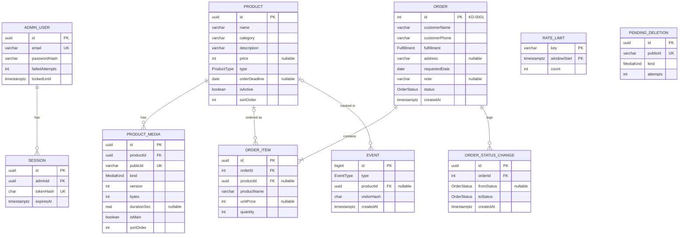

# ERD: Kagumi Dough Website

**Status:** Accepted (2026-11-15)
**Inputs:** [PRD](prd.md), [System Design](system-design.md) §4.8

## 1. Scope

**Covers:** the admin account and sessions, the product catalog and its media, website orders with their lines and status history, analytics events, and two operational tables (rate limits, pending Cloudinary deletions).

**Excluded:** customers as an entity (no accounts; customer details live on the order), payments, stock, delivery fees, and anything stored only in WhatsApp chats. The cart lives in the browser's `localStorage`, not the database.

### Conventions

| Item | Convention |
|---|---|
| ORM / DB | Prisma on Neon Postgres |
| Naming | Prisma models PascalCase, fields camelCase. Tables and columns mapped to snake_case (`@@map` / `@map`) |
| IDs | `uuid` (v7, time-ordered, `@default(uuid(7))`) for most tables. `Order.id` is an auto-increment integer because it doubles as the human order number. `Event.id` is a `bigint` auto-increment (high volume, insert order matters) |
| Time | `timestamptz` for instants, `date` for calendar days (deadlines, requested dates). Calendar days are interpreted in `Asia/Jakarta` |
| Money | Integer rupiah (`int`). No decimals, no currency column |
| Enums | Postgres enums with English values. The UI maps them to Indonesian labels |
| `createdAt` / `updatedAt` | On every table admins edit. Append-only tables have `createdAt` only |
| CHECK constraints | Prisma can't declare them, so they're added in the migration SQL. Listed in §5 |

## 2. Entities

### AdminUser (`admin_users`)

The single admin account. Created and reset by `scripts/create-admin.ts`.

| Field | Type | Constraints | Notes |
|---|---|---|---|
| id | uuid | PK | |
| email | varchar(254) | unique, not null | Stored lowercased |
| passwordHash | varchar(255) | not null | `scrypt$N$r$p$salt$hash` |
| failedAttempts | int | not null, default 0 | Reset on successful login |
| lockedUntil | timestamptz | nullable | Login refused while in the future |
| createdAt | timestamptz | not null, default now() | |
| updatedAt | timestamptz | not null | `@updatedAt` |

### Session (`sessions`)

| Field | Type | Constraints | Notes |
|---|---|---|---|
| id | uuid | PK | |
| adminId | uuid | FK → AdminUser.id, not null, on delete cascade | |
| tokenHash | char(64) | unique, not null | `sha256(token)` hex. The raw token exists only in the cookie |
| expiresAt | timestamptz | not null | Now + 7 days, extended on renewal |
| createdAt | timestamptz | not null, default now() | |

### Product (`products`)

| Field | Type | Constraints | Notes |
|---|---|---|---|
| id | uuid | PK | |
| name | varchar(80) | not null | |
| category | varchar(40) | not null | Free text. The admin form suggests existing values, so the owner can add a new category without a developer |
| description | varchar(500) | not null, default '' | |
| price | int | nullable, CHECK > 0 | Null → "Harga via WA" |
| type | enum `ProductType` (`PRE_ORDER`, `READY_STOCK`) | not null | |
| orderDeadline | date | nullable | Last day orders are accepted (inclusive, WIB) |
| isActive | boolean | not null, default true | false = hidden from the storefront |
| sortOrder | int | not null, default 0 | Ascending on the storefront |
| createdAt | timestamptz | not null, default now() | |
| updatedAt | timestamptz | not null | `@updatedAt` |

### ProductMedia (`product_media`)

One photo or video of a product, stored on Cloudinary.

| Field | Type | Constraints | Notes |
|---|---|---|---|
| id | uuid | PK | |
| productId | uuid | FK → Product.id, not null, on delete cascade | The app queues the asset in PendingDeletion in the same transaction, then destroys it |
| publicId | varchar(255) | unique, not null | Cloudinary public ID |
| kind | enum `MediaKind` (`IMAGE`, `VIDEO`) | not null | Cloudinary resource type |
| version | int | not null | Cloudinary version, used in delivery URLs for cache busting |
| format | varchar(10) | not null | e.g. `jpg`, `heic`, `mp4` |
| width | int | not null | |
| height | int | not null | |
| bytes | int | not null, CHECK > 0 | Verified ≤ 10 MB (image) / 50 MB (video) by the app |
| durationSec | real | nullable | Videos only. Verified ≤ 30 |
| isMain | boolean | not null, default false | At most one per product (partial unique index, §5) |
| sortOrder | int | not null, default 0 | |
| createdAt | timestamptz | not null, default now() | |

### Order (`orders`)

A checkout from the website. Customer details are stored here, with no customer table.

| Field | Type | Constraints | Notes |
|---|---|---|---|
| id | int | PK, auto-increment | Displayed as `KD-` + 4-digit zero-padded id (e.g. `KD-0124`). Gaps after failed transactions are acceptable |
| customerName | varchar(80) | not null | |
| customerPhone | varchar(15) | not null | Customer's WhatsApp number, normalized as `628…` (system design §9). Used for the admin's "Buka chat WhatsApp" link |
| fulfillment | enum `Fulfillment` (`PICKUP`, `DELIVERY`) | not null | |
| address | varchar(300) | nullable, CHECK required when `DELIVERY` | |
| requestedDate | date | not null | |
| note | varchar(500) | nullable | |
| status | enum `OrderStatus` (`NEW`, `CONFIRMED`, `COMPLETED`, `CANCELLED`) | not null, default `NEW` | UI: Baru / Dikonfirmasi / Selesai / Dibatalkan |
| createdAt | timestamptz | not null, default now() | |
| updatedAt | timestamptz | not null | `@updatedAt` |

The subtotal, item count and "has unpriced items" flag are **derived** from `OrderItem`. They aren't stored, because order volume is tiny and aggregating on read is trivial.

### OrderItem (`order_items`)

One product line in an order, with name and price **snapshotted** at checkout so later product edits or deletions don't change past orders.

| Field | Type | Constraints | Notes |
|---|---|---|---|
| id | uuid | PK | |
| orderId | int | FK → Order.id, not null, on delete cascade | |
| productId | uuid | FK → Product.id, nullable, on delete set null | Kept for statistics. Null after the product is deleted |
| productName | varchar(80) | not null | Snapshot |
| unitPrice | int | nullable, CHECK > 0 | Snapshot. Null = priced via WhatsApp |
| quantity | int | not null, CHECK 1–50 | |

### OrderStatusChange (`order_status_changes`)

Append-only history behind the "Riwayat" feed in order detail.

| Field | Type | Constraints | Notes |
|---|---|---|---|
| id | uuid | PK | |
| orderId | int | FK → Order.id, not null, on delete cascade | |
| fromStatus | enum `OrderStatus` | nullable | Null for the initial "order created" entry |
| toStatus | enum `OrderStatus` | not null | |
| createdAt | timestamptz | not null, default now() | |

There's no "changed by" column: there is only one admin, and the creation entry comes from checkout.

### Event (`events`)

Analytics events. Raw rows are deleted after 90 days.

| Field | Type | Constraints | Notes |
|---|---|---|---|
| id | bigint | PK, auto-increment | |
| type | enum `EventType` (`PAGE_VIEW`, `PRODUCT_VIEW`, `ADD_TO_CART`, `CHECKOUT`) | not null | |
| productId | uuid | FK → Product.id, nullable, on delete set null | Set for `PRODUCT_VIEW` and `ADD_TO_CART`. Null otherwise |
| visitorHash | char(64) | not null | `sha256(ip + ua + dailySalt)`. Never the raw IP |
| createdAt | timestamptz | not null, default now() | |

`CHECKOUT` events don't reference the order. Order statistics come from `orders` directly.

### RateLimit (`rate_limits`)

Fixed-window counters for public endpoints (checkout, tracking).

| Field | Type | Constraints | Notes |
|---|---|---|---|
| key | varchar(100) | PK (with windowStart) | e.g. `checkout:<visitorHash>`, `track:<visitorHash>` |
| windowStart | timestamptz | PK (with key) | Start of the 10-minute window |
| count | int | not null, default 1 | Incremented with `INSERT … ON CONFLICT DO UPDATE` |

### PendingDeletion (`pending_deletions`)

Cloudinary assets queued for destroy (deletion through a queue, System Design §4.5): a row is written in the same transaction that deletes the product or medium, and removed after a successful destroy; a failed one stays with its attempts and last error, and the daily cron retries it.

| Field | Type | Constraints | Notes |
|---|---|---|---|
| id | uuid | PK | |
| publicId | varchar(255) | unique, not null | |
| kind | enum `MediaKind` | not null | |
| attempts | int | not null, default 0 | |
| lastError | varchar(500) | nullable | |
| createdAt | timestamptz | not null, default now() | |

No foreign key: the media row is already gone when an asset lands here.

## 3. Relationships

- An `AdminUser` has many `Session`s. A `Session` belongs to one `AdminUser` (1:N, cascade delete).
- A `Product` has many `ProductMedia`. Each `ProductMedia` belongs to one `Product` (1:N, cascade delete).
- An `Order` has one or more `OrderItem`s. Each `OrderItem` belongs to one `Order` (1:N, cascade delete).
- A `Product` appears in many `OrderItem`s. An `OrderItem` references zero or one `Product` (1:N, optional, set null on delete). Together with the previous line this resolves Order ↔ Product (M:N via `OrderItem`).
- An `Order` has many `OrderStatusChange`s (1:N, cascade delete).
- A `Product` is referenced by many `Event`s. An `Event` references zero or one `Product` (1:N, optional, set null on delete).
- `RateLimit` and `PendingDeletion` are standalone (no relationships).

## 4. Diagram

## 5. Indexes & Constraints

**Indexes**

| Table | Index | Serves |
|---|---|---|
| sessions | unique `token_hash`. `expires_at` | Session lookup. Cron cleanup |
| products | `(is_active, sort_order)` | Storefront menu query |
| product_media | `(product_id, sort_order)` | Gallery order |
| product_media | **partial unique** `(product_id) WHERE is_main` | At most one main photo per product |
| orders | `(status, created_at DESC)`. `created_at` | Order list + status filter. Dashboard KPIs |
| order_items | `order_id`. `product_id` | Order detail. "Dipesan" per product |
| order_status_changes | `(order_id, created_at)` | History feed |
| events | `created_at` | Retention delete. Daily visitor counts |
| events | `(type, product_id, created_at)` | Per-product views / add-to-cart |
| rate_limits | `window_start` | Cron cleanup |

The partial unique index is written in raw SQL in the migration, because Prisma doesn't express `WHERE` on indexes.

**CHECK constraints** (migration SQL)

- `products.price IS NULL OR products.price > 0`
- `order_items.unit_price IS NULL OR order_items.unit_price > 0`
- `order_items.quantity BETWEEN 1 AND 50`
- `orders.fulfillment <> 'DELIVERY' OR (orders.address IS NOT NULL AND length(trim(orders.address)) > 0)`. The `IS NOT NULL` is required: without it a NULL address makes the expression NULL, and Postgres accepts a CHECK that evaluates to NULL
- `product_media.bytes > 0`

**Foreign-key behavior**

| FK | On delete | Why |
|---|---|---|
| sessions.admin_id | cascade | Sessions are meaningless without the admin |
| product_media.product_id | cascade | Media belongs to the product. The app queues its Cloudinary assets in `pending_deletions` in the same transaction, then destroys them |
| order_items.order_id | cascade | Lines belong to the order |
| order_items.product_id | set null | Past orders keep their snapshot when a product is deleted |
| order_status_changes.order_id | cascade | History belongs to the order |
| events.product_id | set null | Keep the event (it still counts toward totals) when a product is deleted |

**Rules enforced in the app (not the DB)**

- Only active products whose `orderDeadline` hasn't passed can be checked out (FR12).
- Any order status may change to any other status. Each change is written together with an `OrderStatusChange` row in one transaction. Orders are never hard-deleted from the admin UI.
- `customerPhone` is validated and normalized before it is saved (system design §9).
- Upload limits on `bytes`, `format`, `durationSec` (FR25).

## 6. Open Questions

- **Order deletion:** the admin can cancel but not delete orders. If removing test or spam orders is needed, add an admin delete (cascade already covers items and history).
- **Personal-data retention:** customer name, WhatsApp number, address and note on `orders` are kept for now. A retention period (around 12 months) is decided after launch. That would be an anonymizing job in the daily cron, with no schema change.
