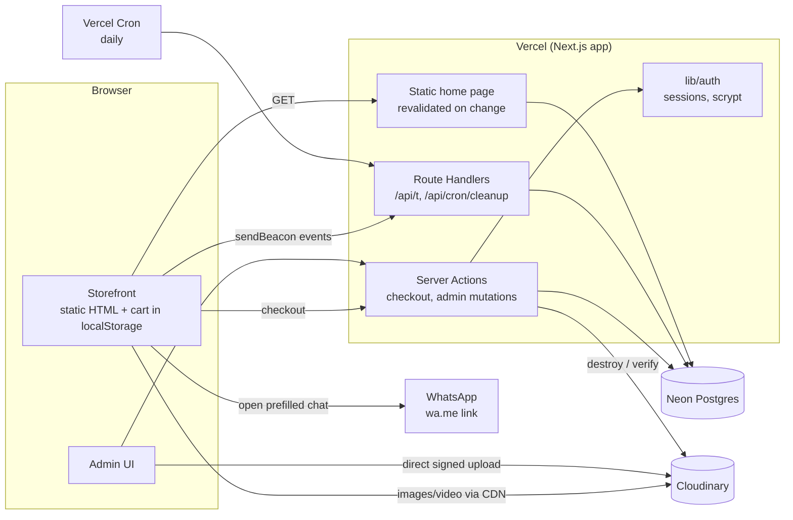
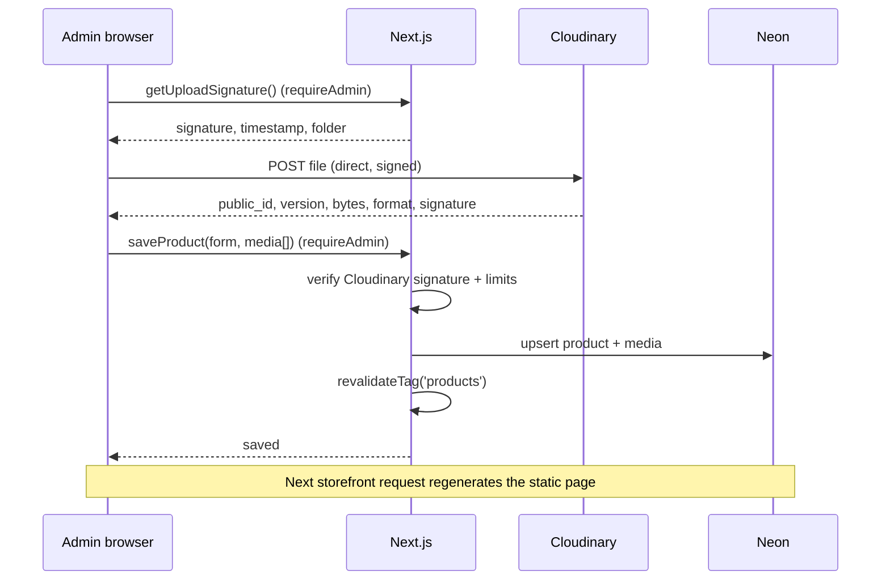

# System Design: Kagumi Dough Website

**Status:** Accepted (2026-11-15)
**Inputs:** [PRD](prd.md), [Design System](design.md)

## 1. Overview

A single Next.js application on Vercel that serves:

- **Storefront** (`/`): the menu, product detail, a cart persisted in the browser, and a checkout that saves the order and opens WhatsApp with a prefilled message.
- **Admin** (`/admin`): login, products and media, orders, and statistics, for one admin account.
- **Internal endpoints:** event tracking, Cloudinary upload signing, and a daily cleanup job.

External services: **Neon** (Postgres), **Cloudinary** (media storage and delivery), and **WhatsApp** (only through a `wa.me` link, with no API integration).

**Out of scope** (from the PRD): online payment, customer accounts, multiple admins, delivery-fee calculation, stock counts, a custom domain, and third-party auth or analytics services.

## 2. Goals & Constraints

| Area | Constraint |
|---|---|
| Timeline | Live before 2026-12-01 (~2 weeks), one developer |
| Cost | Free tiers only: Vercel Hobby, Neon Free, Cloudinary Free |
| Scale | Tens of orders per week, low hundreds of visitors per day at peak (hampers season) |
| Dependencies | Auth, statistics and Cloudinary signing built in-house with Node built-ins (`crypto`). No auth or analytics libraries |
| Performance | Home page statically rendered. Lighthouse mobile ≥ 90, LCP < 2.5 s on 4G |
| Freshness | Admin changes visible on the storefront within 1 minute (PRD FR7) |
| Reliability | An order must never be lost because the backend failed (PRD FR14) |
| UX | Mobile-first, light/dark theme, WCAG 2.1 AA ([design.md](design.md)) |

## 3. High-Level Architecture

A **monolith**: one Next.js (App Router) project with route groups for the storefront and admin, and Server Actions plus a few Route Handlers as the backend. Splitting it into a separate frontend and API would add a second deploy and a CORS/auth boundary with no benefit at this scale.



## 4. Component Breakdown

### 4.1 Project layout

```
src/
  app/
    (store)/page.tsx            home: hero, menu, how-to-order, CTA (static + revalidate)
    (store)/actions.ts          createOrder (Server Action)
    admin/actions.ts            login, logout (Server Actions; logout calls requireAdmin())
    admin/login/page.tsx
    admin/(protected)/layout.tsx  requireAdmin() + shell (sidebar / bottom nav)
    admin/(protected)/page.tsx            overview
    admin/(protected)/pesanan/...         orders list + detail
    admin/(protected)/produk/...          products list + form
    admin/(protected)/statistik/page.tsx
    api/t/route.ts              event tracking (POST)
    api/cron/cleanup/route.ts   daily cleanup (GET, CRON_SECRET)
  components/                   UI built from design.md tokens (CSS Modules)
  lib/
    db.ts                       Prisma client (Neon adapter)
    auth.ts                     login attempts and lockout, sessions, getAdmin(), requireAdmin() (server only)
    password.ts                 scrypt hashing and verification, normalizeEmail (imports only node:crypto, so scripts/ can load it)
    cloudinary.ts               sign upload, verify response, destroy, delivery URLs
    tracking.ts                 visitor hash, bot filter, rate limit (server only)
    checkout.ts                 the checkout transaction behind createOrder (server only)
    order.ts                    order number, WhatsApp message builder
    validation.ts               Zod schemas shared by client and server
    menu.ts                     storefront product types and the closed/sort rules (client-safe)
    cart.ts                     cart parsing and line rules (client-safe)
  styles/tokens.css             all design tokens (light + dark)
prisma/schema.prisma, prisma/migrations/
scripts/create-admin.ts         create/reset the admin account from env vars
tests/ (Vitest)  e2e/ (Playwright)
```

### 4.2 Storefront

- **Rendering:** the home page is a Server Component that reads active products (with media) from Neon at build/revalidate time. It's cached as static HTML and tagged `products`. Every admin mutation that affects the storefront calls `revalidateTag('products')`, so changes appear on the next request (well within the 1-minute target). There is also a time-based fallback revalidation of 1 hour.
- **Closed products:** whether a PO is closed depends on the current date, but the page is cached. So the server embeds `orderDeadline`, and a small client component computes "closed" at render in the browser (Asia/Jakarta). The same component moves closed products to the end of the menu (FR5). It reads the date again when the tab becomes visible, so a page left open past a deadline shows the product as closed without a reload. The server re-checks at checkout (4.3).
- **Date-dependent copy:** that client component also derives two pieces of the page from the open pre-orders, so the admin never edits them by hand. The notice bar shows its "Open pre-order" phrase only while at least one pre-order product is open, and otherwise shows the delivery-area text alone. The hero promo card shows the open pre-order with the nearest order deadline (pre-orders without a deadline come after those with one), and is hidden when no pre-order is open.
- **Product detail:** a client `<dialog>` fed by data already on the page (all media URLs are included), so opening it costs no request. The PRD doesn't require shareable product URLs, so there's no `/produk/[slug]` route in the MVP.
- **Cart:** React context + `localStorage` (`kagumi-cart`, product IDs and quantities only). Names and prices are always read from the page data, so a stale cart can't show a stale price, and the server re-prices at checkout anyway.
- **Theme:** inline `<head>` script applies `localStorage['kagumi-theme']` before paint ([design.md](design.md) §2.6).

### 4.3 Checkout (`createOrder` Server Action)

1. Validate input with the shared Zod schema: name, WhatsApp number (§9), pickup/delivery, address required when delivery, date ≥ today, note ≤ 500 chars, 1–20 lines, quantity 1–50.
2. Rate-limit by visitor hash: max 5 checkouts per 10 minutes. This blocks order spam from the public form.
3. Load the products from the DB. Reject if any product is missing, hidden, or past its `orderDeadline` (FR12).
4. In one transaction: insert the `orders` row, its `order_items` (snapshotting name and unit price, FR13), the initial `order_status_changes` row (no previous status → `NEW`) and the `CHECKOUT` event. The order number is the order's auto-increment id, formatted as `KD-0001`.
5. Build the WhatsApp message on the server (`lib/order.ts`) and return `{ orderNumber, waUrl }`. The customer's WhatsApp number is stored on the order but left out of the message, because the chat already shows the sender's number.

   Message template (lines joined with `\n`, built by `buildOrderMessage`, the same function on the server and in the browser):

   ```
   Halo Kagumi Dough! Aku mau pesan (dari website)

   No. pesanan: KD-0065
   • 2× Hampers Natal — Rp70.000
   • 1× Bolu Gulung — harga via WA

   Subtotal: Rp70.000 (+ 1 produk harga via WA)
   Nama: Rina
   Pengambilan: Diantar
   Alamat: Jl. Slamet Riyadi No. 1, Laweyan
   Tanggal: Minggu, 20 Desember 2026
   Catatan: Kartu ucapan "Selamat Natal"
   ```

   | Part | Rule |
   | --- | --- |
   | Header | Always `Halo Kagumi Dough! Aku mau pesan (dari website)`, then one empty line |
   | Order number | `No. pesanan: KD-0065` (§9 format, no `#`). **Fallback (step 7): this line is left out**, so the lines follow the empty line directly |
   | Line | `• {qty}× {name} — {line total}`; line total = `Rp` + `qty × unitPrice`; unpriced: `harga via WA`. Order = cart order. Names and prices: the database snapshot on the server, the page data in the fallback |
   | Empty line | After the last line |
   | Subtotal | All priced: `Subtotal: Rp70.000`. Some unpriced: `Subtotal: Rp70.000 (+ n produk harga via WA)`. None priced: `Subtotal: harga via WA` |
   | Customer | `Nama:` · `Pengambilan: Ambil sendiri` or `Pengambilan: Diantar` · `Alamat:` only for delivery · `Tanggal: {Hari}, {d} {Bulan} {yyyy}` · `Catatan:` only when the note is not blank. Values trimmed. The customer's WhatsApp number is never in the message |
   | URL | `https://wa.me/6285159545168?text=` + `encodeURIComponent(message)`, after a lone UTF-16 surrogate in the message is replaced with U+FFFD (it would make the encoding throw) |

6. The client clears the cart, shows the confirmation step, and **navigates in the same tab** to `waUrl` (`window.location.href`). Opening a new window after an `await` is blocked by mobile popup blockers.
7. **Fallback (FR14):** if the action fails (network, DB down), the client builds the same message without an order number from the cart, shows a notice, and still opens WhatsApp. The order then exists only in chat, and the admin can add it manually later if needed. In this case the cart is kept, so nothing is lost if WhatsApp doesn't open.

The `CHECKOUT` event is written by the server inside that transaction, not sent as a beacon, because a beacon from a page that's about to navigate away is unreliable.

**Contract.** `createOrder(input: unknown): Promise<CreateOrderResult>` is the only export of `(store)/actions.ts`. The transaction lives in `lib/checkout.ts` (`placeOrder`, `checkout`), so the core can be tested without a request.

```ts
type CreateOrderResult =
  | { ok: true; orderNumber: string /* "KD-0065" */; waUrl: string }
  | { ok: false; error: "validation"; fields: Partial<Record<keyof CheckoutInput, string>> } // one Indonesian message per field; a non-object gives {}
  | { ok: false; error: "rate_limited" }
  | { ok: false; error: "rejected"; lines: { productId: string; reason: "closed" | "unavailable" }[] } // every bad line: missing or hidden → unavailable, past deadline → closed
  | { ok: false; error: "server" }; // anything thrown; rolled back; one console.error line with the error name and code, never input values
```

Steps 1–4 run in one interactive transaction, in this order: validation (invalid input writes nothing), rate limit, product load, writes. A `rejected` or `rate_limited` result commits the counter only.

**Visitor and rate limit.** The IP is the first entry of `x-forwarded-for`, trimmed, else `x-real-ip`, else `""`; on Vercel the platform overwrites both with the client IP. The user agent is `user-agent`, else `""`. The visitor hash is §4.6 step 3; a missing `TRACKING_SECRET` throws and gives `server`. The checkout counter is the `rate_limits` row with key `checkout:<visitorHash>` and `window_start = floor(epoch_ms / 600000) × 600000` (fixed 10-minute UTC windows), incremented by one `INSERT … ON CONFLICT (key, window_start) DO UPDATE SET count = rate_limits.count + 1 RETURNING count`. A checkout is allowed while the count is ≤ 5. The upsert holds the row lock until commit, so concurrent checkouts of one visitor are counted without a lost update.

### 4.4 Admin authentication (`lib/auth.ts`)

| Concern | Design |
|---|---|
| Account | One row in `admin_users`, created or reset by `scripts/create-admin.ts` from `ADMIN_EMAIL` / `ADMIN_PASSWORD`. No sign-up route |
| Account script | `node scripts/create-admin.ts` loads `.env`, refuses any database but the development branch (the seed's guard), then imports the Prisma client. Input: `ADMIN_EMAIL` trimmed and lowercased, exactly one `@`, at most 254 characters; `ADMIN_PASSWORD` 12–1024 characters. In one transaction it inserts the admin, or updates it by email (new hash, `failed_attempts = 0`, `locked_until = NULL`) and deletes that admin's sessions; other admin rows are untouched. Prints exactly `admin account created` or `admin account reset`, never the email, password or hash; a broken rule exits 1 with a message naming the rule, not the value |
| Password hash | `crypto.scrypt` (N=16384, r=8, p=1, 64-byte key) with a 16-byte random salt, stored as `scrypt$N$r$p$salt$hash` so the parameters can be raised later: `scrypt$16384$8$1$<salt: 32 hex>$<key: 128 hex>` (178 characters). Verification reads N, r, p from the stored string; a malformed string verifies as false without throwing (`lib/password.ts`) |
| Session | 32-byte `crypto.randomBytes` token sent in the cookie as base64url (43 characters). The DB stores only `sha256(token)` as 64 hex characters, so a DB leak doesn't expose live sessions. Created at login with `expires_at = now + 7 days` (other sessions of the admin are left alone). Looked up by the hash with `expires_at > now`; an expired row counts as no session and is left for the cron. When less than 1 day remains, the lookup sets `expires_at = now + 7 days`; the cookie is unchanged |
| Cookie | `kd_session`, `HttpOnly; Secure; SameSite=Lax; Path=/`, with no `Max-Age` or `Expires`: `sessions.expires_at` is the only clock, because a Server Component can't reissue a cookie when the session is renewed |
| Lockout | `failed_attempts` and `locked_until` on `admin_users`. 5 failures → locked for 15 minutes. A successful login resets them. Each attempt first runs one atomic `UPDATE … RETURNING` on an unlocked account (`locked_until IS NULL OR locked_until <= now`) that adds 1 to the counter, or on the fifth sets `locked_until = now + 15 min` and the counter back to 0; concurrent attempts are serialized by the row lock, so at most 5 passwords are checked per lock window. While locked, attempts are refused even with the right password, aren't counted and don't extend the lock. Unknown emails are counted nowhere. Empty or over-1024-character passwords fail before any query |
| Timing | Exactly one scrypt per attempt: unknown email and locked account run it against a dummy hash (computed once per process). Comparisons use `crypto.timingSafeEqual`. One generic error message for every failure |
| Enforcement | `requireAdmin()` is called at the top of the protected layout, at the top of every admin page (layouts don't re-render on client navigation), and inside every admin Server Action and Route Handler (FR21). The only public Server Actions are `createOrder` and `login`; `tests/admin-actions.test.ts` imports every `"use server"` file, every page, layout, template and default under `admin/(protected)/` (only the login page may sit outside it) and every route handler under `admin/` and `api/`, and fails when one of them doesn't redirect to `/admin/login` without a live session (no cookie, or a token with no session row). `/api/t` (§4.6) and `/api/cron/cleanup` (§4.7) are public by their own rules and enter the test only through an approved allow-list. Middleware/proxy only redirects unauthenticated page visits to `/admin/login` for convenience and is never the security boundary |
| CSRF | Server Actions only accept same-origin POSTs (Next.js checks `Origin`), plus `SameSite=Lax`. No custom token needed |
| Logout | Deletes the session row and clears the cookie |

### 4.5 Media (`lib/cloudinary.ts`)

- **Upload:** the admin form asks a Server Action for a signature (`requireAdmin()` → `timestamp`, `folder=kagumi/products`, `allowed_formats`, signed with `CLOUDINARY_API_SECRET` via `crypto` SHA-256). The browser uploads **directly** to Cloudinary, so large files never pass through Vercel functions (Hobby request-body limits).
- **Verification:** file size isn't a signable upload parameter, so the client checks size and duration before uploading, and the server checks again when the media row is saved. The server verifies Cloudinary's response signature (`public_id` + `version`), then checks `bytes`, `format` and `duration` against FR25 (image ≤ 10 MB, video ≤ 50 MB and ≤ 30 s). If a check fails, the server destroys the asset and rejects the save.
- **Delivery:** URLs use Cloudinary transformations: `f_auto,q_auto,c_fill,w_{size}` for images and `f_auto,q_auto,vc_auto` for video, with a poster from `so_0`. `next/image` uses a custom Cloudinary loader so Vercel's image optimizer (and its free-tier quota) isn't used.
- **Deletion:** deleting media or a product calls the Cloudinary destroy API (signed in-house). If a destroy call fails, it's logged, and the daily cron retries assets recorded in `pending_deletions`.

### 4.6 Statistics (`lib/tracking.ts`, `/api/t`)

- **Client:** `navigator.sendBeacon('/api/t', {type, productId?})` for `page_view`, `product_view`, `add_to_cart`. `checkout` is recorded by the server (4.3).
- **Endpoint:**
  1. Drop requests from known bot user agents (`bot|crawl|spider|preview|lighthouse|headless`).
  2. Validate the body with Zod: the type is one of the 3 client types, and the product ID exists in the active product list (cached).
  3. Compute `visitor = sha256(ip + ua + dailySalt)`, where `dailySalt = HMAC(TRACKING_SECRET, YYYY-MM-DD in Asia/Jakarta)`. Nothing to store or rotate, raw IPs never persist, and hashes can't be linked across days.
  4. Rate-limit: max 60 events per visitor per 10 minutes, counted in `rate_limits`.
  5. Insert into `events`. Respond `204` either way.
- **Dashboard queries:** aggregates computed on request with `GROUP BY date_trunc('day', created_at AT TIME ZONE 'Asia/Jakarta')`, served by indexes on `(created_at)` and `(type, product_id, created_at)`. At ≲ 100k rows this stays in milliseconds, so there are no pre-aggregated tables. Order KPIs come from `orders`. The headline numbers and the visitors chart run the same query for the previous period of the same length (FR35). The 90-day retention covers the 30-day view and its previous 30 days.

### 4.7 Daily cron (`/api/cron/cleanup`)

Runs once a day via `vercel.json` (`0 19 * * *` UTC = 02:00 WIB). The request is authorized by `Authorization: Bearer ${CRON_SECRET}`. The job:

- deletes events older than 90 days (FR34)
- deletes expired sessions and stale `rate_limits` rows
- retries `pending_deletions` on Cloudinary

### 4.8 Data model (summary)

Full fields, indexes and constraints are in the [ERD](erd.md). Entities:

| Entity | Key fields |
|---|---|
| `admin_users` | email, password_hash, failed_attempts, locked_until |
| `sessions` | token_hash, admin_id, expires_at |
| `products` | name, category, description, price (nullable, integer rupiah), type (`PRE_ORDER` / `READY_STOCK`), order_deadline (nullable date), is_active, sort_order |
| `product_media` | product_id, public_id (Cloudinary), kind (`IMAGE` / `VIDEO`), version, format, width, height, bytes, duration_sec, is_main, sort_order |
| `orders` | id (auto-increment, shown as `KD-0001`), customer_name, customer_phone, fulfillment (`PICKUP` / `DELIVERY`), address, requested_date, note, status (`NEW` / `CONFIRMED` / `COMPLETED` / `CANCELLED`), created_at. Subtotal is derived from items |
| `order_items` | order_id, product_id (nullable after delete), product_name, unit_price (nullable), quantity |
| `order_status_changes` | order_id, from_status, to_status, created_at (powers the "Riwayat" feed) |
| `events` | type, product_id, visitor_hash, created_at |
| `rate_limits` | key, window_start, count |
| `pending_deletions` | public_id (Cloudinary), kind, attempts, last_error |

Money is stored as an integer in rupiah. There are no decimals and no currency column.

### 4.9 Order management (admin)

- **List** (`/admin/pesanan`): orders newest first, with item count and subtotal aggregated from `order_items`. Filter by status. Search matches the customer name (case-insensitive, contains) or the order number (`KD-0123`, `0123` or `123`).
- **Detail:** everything saved at checkout, the lines with their snapshot prices, the history from `order_status_changes`, and a "Buka chat WhatsApp" link to `wa.me/<customer number>` with a prefilled greeting that names the order number.
- **Status change** (Server Action, `requireAdmin()`): any status may change to any other status (FR29). The action updates `orders.status` and inserts the `order_status_changes` row in one transaction. Setting the status the order already has does nothing. Status changes don't affect the storefront, so nothing is revalidated.
- **Activity feed and status bar** (overview): derived on request from three sources: orders created, status changes, and open pre-orders that have an order deadline (shown as days left). There is no separate log table, so product edits don't appear in the feed. The status bar counts orders with status `NEW` and open pre-orders.

### 4.10 Environments and deployment

| Environment | Runs on | Database | Migrations |
|---|---|---|---|
| Production | Vercel production deployment | Neon production branch | Applied by the build step, before the Next.js build, with Prisma's deploy command (ADR-0002): the `vercel-build` script in `package.json` is `prisma migrate deploy && next build`, and Vercel runs it instead of `build`. A failed migration fails the build, and the previous deployment keeps serving. A local `npm run build` runs only `next build`: it applies no migration and writes to no database. The static storefront still reads products at build time (§4.2): locally from the development branch in `.env`, on Vercel from each environment's branch |
| Preview | Vercel preview deployments | Neon development branch (§9) | Same build step, against the development branch |
| Local | Developer machine | Neon development branch (§9) | Generated with Prisma's diff command, checked for drops of the raw-SQL CHECK constraints and the partial unique index, then applied with Prisma's deploy command. Never the development migration command: it needs a shadow database and would drop the raw-SQL objects |

- Each Vercel environment has its own `DATABASE_URL` and `DIRECT_URL`. The production values are set only for the Production environment.
- The variables are entered by hand per Vercel environment. The Neon Vercel integration is not installed: it would create a database branch per preview deployment, while previews must use the one development branch.
- Vercel Cron runs only on the production deployment, so the cleanup job never touches the development branch.
- Migrations must stay compatible with the deployment that is live while the new one builds: add columns and tables first, and remove old ones in a later deploy.

## 5. Data Flow

### 5.1 Checkout

```mermaid
sequenceDiagram
  participant C as Customer browser
  participant N as Next.js (Server Action)
  participant D as Neon
  participant W as WhatsApp
  C->>N: createOrder(cart, form)
  N->>D: BEGIN (one interactive transaction, §4.3)
  N->>N: Zod validate
  alt invalid input
    N-->>C: validation: one message per field (nothing written)
  else 6th checkout of this visitor in the 10-minute window
    N->>D: rate-limit upsert (count + 1); COMMIT
    N-->>C: rate_limited (only the counter is saved)
  else a line missing, hidden or past its deadline
    N->>D: rate-limit upsert; load products; COMMIT
    N-->>C: rejected: every bad line → show in cart (only the counter is saved)
  else ok
    N->>D: rate-limit upsert; load products; insert order + items + status change + checkout event; COMMIT
    N-->>C: { orderNumber, waUrl }
    C->>C: clear cart, show confirmation
    C->>W: location.href = waUrl
  end
  Note over C,W: Any throw rolls everything back and returns server. If the action fails: build message locally (no number) and open WhatsApp anyway
```

### 5.2 Admin edits a product with a new photo



## 6. Technology Choices & Trade-offs

| Area | Choice | Why | Trade-off | Alternative |
|---|---|---|---|---|
| Framework | **Next.js (App Router)** | Storefront and admin in one app. Static rendering + Server Actions. First-class on Vercel | Framework complexity (caching rules, server/client split) | Astro: great for the storefront, but the admin would still need React islands and a separate API |
| Hosting | **Vercel Hobby** | Free, zero-config Next.js deploys, Cron included | Hobby is for non-commercial use (accepted risk, PRD §9). Daily cron only. Function limits | Vercel Pro (~$20/mo, no code change), Netlify |
| Database | **Neon Postgres (Free)** | Serverless Postgres, scales to zero, integrates with Vercel | Cold start (~0.5 s) on the first query after idle. 0.5 GB storage. Monthly compute allowance | Supabase (more bundled features we don't use) |
| ORM | **Prisma** (Rust-free client + `@prisma/adapter-neon`) | Typed client, readable schema, mature migrations (`prisma migrate`). The developer's choice | Heavier than Drizzle (bigger bundle, slower cold start). Needs the driver adapter for serverless and a direct (unpooled) URL for migrations | Drizzle (lighter), raw SQL |
| Media | **Cloudinary (Free)** | Automatic resizing, format conversion, video transcoding and posters for phone uploads. CDN delivery | 25 credits/month shared by storage, bandwidth and transforms. Vendor-specific URLs | Cloudflare R2: more storage, but no processing (we'd build it) |
| Cloudinary client | **No SDK.** Signing, verification and destroy with `crypto` + `fetch` | Three small endpoints. Keeps dependencies minimal, consistent with in-house auth | We maintain ~80 lines and must follow Cloudinary's signing rules exactly (covered by tests) | Official `cloudinary` SDK |
| Auth | **In-house** (4.4) | One admin, email + password. No library needed | Security details are on us. Must be reviewed before launch | Better Auth / Auth.js |
| Analytics | **In-house events table** (4.6) | Business events (product views, add to cart, checkout) that free hosted analytics don't offer | Every visit writes to Neon (keeps compute awake). We own bot filtering and rate limiting | Vercel Web Analytics (page views only on Hobby) |
| Validation | **Zod** | One schema for client forms and server checks | One dependency | Hand-written checks |
| Styling | **CSS Modules + global tokens** | Matches the approved previews 1:1. Tokens map directly from [design.md](design.md) | No utility classes. Component CSS written by hand | Tailwind (would mean translating every token and component) |
| Testing | **Vitest + Playwright** | Unit tests for auth, signing, order/message building, tracking. A few E2E flows for the critical paths | Playwright adds CI time | Vitest only |

The choices most expensive to reverse are recorded as ADRs: [ADR-0001](adrs/0001-in-house-admin-authentication.md) (in-house authentication), [ADR-0002](adrs/0002-prisma-on-neon-serverless.md) (Prisma on Neon), [ADR-0003](adrs/0003-in-house-analytics-events.md) (in-house analytics).

## 7. Scaling & Cost Considerations

**Expected load:** ~500 visitors/week (peak season ×3), ~5 events each → ~2.5–7.5k event rows/week, ~100k rows per 90 days at most. Tens of orders per week. All of this fits comfortably in the free tiers.

| Resource | Pressure point | Mitigation / next step |
|---|---|---|
| Neon compute | Tracking writes keep the DB awake during traffic | Acceptable now. If compute runs out: batch events client-side (send on `visibilitychange`), or sample `page_view` |
| Neon storage (0.5 GB) | Events table | 90-day retention. ~100k small rows is a few tens of MB |
| Cloudinary credits | Video bandwidth during campaigns | Upload limits (FR25), `q_auto`, posters instead of autoplay, lazy-load media in the dialog only |
| Vercel functions | Home page served statically, so functions run only for checkout, tracking, and admin | Fine at this scale |
| Vercel Hobby terms | Commercial use | Move to Pro (no code change) |
| Cold starts | Prisma + Neon on the first admin request after idle (~1–2 s) | Acceptable for one admin. The storefront is static and unaffected |

**When this design must change:** at sustained thousands of orders per day, or if multiple staff need accounts. That would mean pre-aggregating statistics, adding roles, and probably a paid plan. Neither is expected.

## 8. Security Considerations

- **Admin boundary:** see 4.4. Every server entry point checks the session itself.
- **Public write endpoints** (checkout, tracking): Zod validation, server-side re-pricing and product checks, per-visitor rate limits, no trust in client-sent prices or names.
- **Personal data:** orders hold names, WhatsApp numbers, addresses and notes. They're visible only in the admin. They never appear in URLs, logs or analytics. Analytics stores only daily-rotating visitor hashes.
- **XSS:** React escapes output. The WhatsApp message is built server-side and URL-encoded. No `dangerouslySetInnerHTML` with user or admin content.
- **Secrets** (Vercel env only, never shipped to the client): `DATABASE_URL`, `DIRECT_URL`, `CLOUDINARY_API_SECRET`, `TRACKING_SECRET`, `CRON_SECRET`, `ADMIN_EMAIL`/`ADMIN_PASSWORD` (seed only). Only `NEXT_PUBLIC_CLOUDINARY_CLOUD_NAME` and the WhatsApp number are public.
- **Uploads:** only signed uploads, signatures only for a logged-in admin, response signature and limits verified before saving (4.5).
- **SQL injection:** Prisma parameterizes all queries. Raw SQL only through tagged templates.
- **Headers:** `Content-Security-Policy` allowing self, Cloudinary (`res.cloudinary.com`, `api.cloudinary.com`). Fonts are self-hosted ([design.md](design.md) §3), so no font origin is needed. `script-src` is `'self' 'unsafe-inline'`: the home page is static, and both the theme script (4.2) and Next.js's own bootstrap scripts are inline. A nonce-based policy would force every page to render dynamically and break the static-rendering requirement. So the CSP limits where scripts load from and where the page may connect or be framed, and protection against injected markup rests on React's escaping. Plus `X-Frame-Options: DENY` and `Referrer-Policy: strict-origin-when-cross-origin`.

## 9. Configured Values

| Name | Value |
|---|---|
| WhatsApp number | `6285159545168` |
| Order number format | `KD-` + 4-digit zero-padded sequence |
| Timezone for dates, deadlines, stats | `Asia/Jakarta` (WIB) |
| Session lifetime | 7 days (renew under 1 day left) |
| Login lockout | 5 failures → 15 minutes |
| Checkout rate limit | 5 per visitor per 10 minutes |
| Tracking rate limit | 60 events per visitor per 10 minutes |
| Event retention | 90 days |
| Upload limits | Image ≤ 10 MB (JPEG, PNG, WebP, HEIC). Video ≤ 50 MB, ≤ 30 s (MP4, MOV) |
| Cart limits | 1–20 lines, quantity 1–50 per line |
| Customer WhatsApp number | Indonesian mobile number. Accepts `08…`, `628…` or `+628…`, stored normalized as `628…`, 10–15 digits |
| Order status transitions | Any status to any other. Every change is recorded in `order_status_changes` |
| Storefront revalidation | On-demand (`products` tag) + 1-hour fallback |
| Cron schedule | `0 19 * * *` UTC (02:00 WIB) |
| Cart / theme storage keys | `kagumi-cart`, `kagumi-theme` |
| Hosting region | Vercel functions in `sin1` (Singapore), set by `regions` in `vercel.json`. Neon in AWS `ap-southeast-1` (Singapore) |
| Development and test database | A separate Neon branch, treated as disposable. Tests, seeds and scripts run from a developer machine use only this branch, never the production branch |

## 10. Verification Plan

| What | How |
|---|---|
| Password hashing, session create/verify/expire, lockout, timing-safe compare | Vitest unit tests against the development branch (§9) |
| `requireAdmin()` on every admin action/route | Vitest: call each admin Server Action and Route Handler without a session and expect rejection. A test lists all exported admin actions so new ones can't skip it |
| Cloudinary signing and response verification | Vitest with Cloudinary's documented example signatures |
| Checkout validation, re-pricing, closed/hidden product rejection, rate limit, message format | Vitest |
| Tracking: bot filter, invalid type/product, rate limit, visitor hash rotation | Vitest |
| Order status change writes the status and its history row together. Order search by name and number | Vitest |
| Critical flows | Playwright: add to cart → checkout → order appears in admin. Admin login (success, wrong password, lockout). Product edit visible on the storefront |
| Accessibility & performance | Lighthouse mobile on the production preview: Performance ≥ 90, Accessibility ≥ 95, both themes |
| Pre-launch security review | Manual review of 4.4–4.6 and §8 before going live |

## 11. Open Questions / Risks

- **Timeline:** the full scope in ~2 weeks is the main risk (PRD §9). Build order: storefront + cart → checkout/orders → auth → products + media → statistics.
- **Personal data retention:** decided 2026-11-15: customer names and addresses in `orders` are kept for now. A retention period (around 12 months) is set after launch.
- **Prisma bundle size and cold start** on Vercel functions: check during setup that the Rust-free client + Neon adapter work as expected. Fall back to the pooled connection string with the standard driver if needed.
- **WhatsApp hand-off on iOS/in-app browsers** (Instagram's in-app browser): test that `location.href = wa.me/...` opens WhatsApp. The confirmation screen keeps a "Buka WhatsApp lagi" button as a manual fallback.
- **Order spam:** rate limits slow it down but can't stop a determined attacker. If it happens, add a lightweight challenge later.
- **Fonts:** decided 2026-11-16: both fonts are self-hosted ([design.md](design.md) §3).

---

Related documents: [PRD](prd.md), [ERD](erd.md), [Design System](design.md), [ADRs](adrs/README.md).
